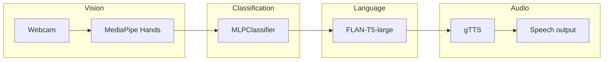

# Sign Language Multimodal System

[](https://www.python.org/downloads/)
[](https://jupyter.org/)
[](LICENSE)

**Vision → language → speech:** recognize static hand signs from a webcam using [MediaPipe](https://google.github.io/mediapipe/solutions/hands) hand landmarks, classify gestures with a small neural network, turn labels into natural sentences with [FLAN-T5](https://huggingface.co/google/flan-t5-large), and speak them with [gTTS](https://pypi.org/project/gTTS/).

Originally developed as a course project (**AIN4311** — Special Topics in Artificial Intelligence Engineering).

---

## Why this repo exists

Deaf and hard-of-hearing communities often face barriers when others do not know sign language. This project is a **compact educational prototype**: it is not a production sign-language translator (real SL is rich, grammatical, and varies by region), but it shows how multimodal pipelines can connect perception, text generation, and audio in one notebook.

---

## Features

| Layer | What it does |
|--------|----------------|
| **Vision** | Single-hand landmarks (21 × 3 values) via MediaPipe + OpenCV |
| **Recognition** | `MLPClassifier` (scikit-learn) on collected CSV data |
| **Language** | FLAN-T5–large with a constrained prompt for short, context-aware English |
| **Audio** | Google Text-to-Speech (`gTTS`) + playback in Jupyter |

**Gestures in the sample dataset:** `HELLO`, `YES`, `NO`, `THANK YOU` (40 samples each, 160 total; ~97% hold-out accuracy in the bundled run).

---

## Architecture



---

## Repository layout

| Path | Description |
|------|-------------|
| `Midterm_SignLanguage_Multimodal_System.ipynb` | Full pipeline: install, data, train, TTS, live loop |
| `gesture_data.csv` | Landmark features + gesture labels |
| `images/` | Diagrams and screenshots for reports or docs |
| `report/` | Written report (PDF/DOCX) |
| `requirements.txt` | Python dependencies |

---

## Quick start

1. **Clone** the repository and enter the project directory.

2. **Create a virtual environment** (recommended):

   ```bash
   python3 -m venv .venv
   source .venv/bin/activate   # Windows: .venv\Scripts\activate
   pip install -r requirements.txt
   ```

3. **First run downloads models** — FLAN-T5–large is several GB; ensure disk space and a stable connection.

4. **Open the notebook**:

   ```bash
   jupyter notebook Midterm_SignLanguage_Multimodal_System.ipynb
   ```

5. **Webcam** — Data collection and the live demo need a working camera. In the live window, press **`s`** to synthesize speech for the current gesture and **`q`** to quit.

---

## Large demo video

Screen recordings or full demos can exceed [GitHub’s 100 MB file limit](https://docs.github.com/en/repositories/working-with-files/managing-large-files/about-large-files-on-github). This repo’s `.gitignore` excludes `images/demo_video.mov` for that reason.

**Good options for a public portfolio:**

- Upload the video to **YouTube** or **Vimeo** and link it from this README.
- Use **[Git LFS](https://git-lfs.com)** if you need the binary in Git history.
- Attach the video to a **GitHub Release** (still subject to size limits; LFS or external hosting is safer for very large files).

---

## Suggested GitHub settings (polish)

1. **Repository description** (short): e.g. *“Multimodal sign-gesture pipeline: MediaPipe → MLP → FLAN-T5 → gTTS.”*
2. **Topics / tags:** `sign-language`, `mediapipe`, `multimodal`, `pytorch`, `transformers`, `opencv`, `accessibility`, `jupyter`, `education`
3. **Social preview:** *Settings → General → Social preview* — use `images/Vision → Text → Audio Pipeline.png` or another clear diagram after pushing.
4. **About → Website** — optional link to a demo video or portfolio page.

---

## Privacy note

The notebook header may contain **course metadata** (name, student ID, dates). Before making the repo public, decide whether to **redact** IDs you do not want indexed by search engines. The code and dataset contain **no** third-party personal data by design.

---

## License

This project is released under the [MIT License](LICENSE). Third-party models (e.g. FLAN-T5) and APIs (gTTS) are subject to their own terms.

---

## Acknowledgements

- [MediaPipe](https://mediapipe.dev/) for hand tracking  
- [Hugging Face Transformers](https://huggingface.co/docs/transformers) for FLAN-T5  
- Course **AIN4311** for the project framing  

If you use this work academically, cite the repository URL and the report in `report/` as your institution requires.
